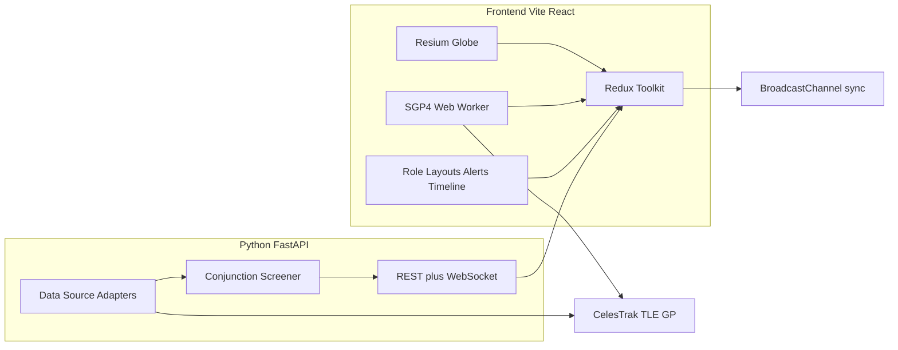

# SSA Operations Dashboard — Plan

Greenfield Vite + React + TypeScript frontend with Cesium/Resium, a FastAPI conjunction-screening service, Redux Toolkit state, role-configurable layouts, and Docker/CI — built in four phases toward an interview-ready SSA operations demo.

## Architecture



**Data-source adapter pattern (backend):** `CatalogueAdapter` protocol with `CelesTrakAdapter` first; a federated/mock source is another adapter implementing the same interface. Frontend never holds API keys — only public CelesTrak URLs and the FastAPI base URL.

**Repo layout**

```
SSA/
  apps/web/                 # Vite + React + TS
  services/conjunction/     # FastAPI + pytest
  packages/shared/          # shared types / Zod or JSON Schema (optional thin)
  docker-compose.yml
  .github/workflows/ci.yml
  docs/architecture.md
  scenarios/                # replay JSON (debris event)
```

## Phase 1 — Cesium globe + live satellites ✅

**Status:** implemented in `apps/web`.

**Core UI**
- Full-bleed dark Cesium viewer via Resium (`Viewer`, `Entity`, `Polyline` orbits).
- Load public GP/TLE from CelesTrak (e.g. active sats + debris subsets; cap ~2–5k for demo smoothness, with pagination/filter).
- Filters: orbit regime (LEO/MEO/GEO/HEO heuristic from mean motion / eccentricity), operator/group where present in metadata.
- 2D/3D scene mode toggle (Cesium `SceneMode`).

**Propagation worker**
- Web Worker runs SGP4 (`satellite.js`) on a tick (e.g. 1 Hz or rAF-batched), posts `{ id, position }` batches.
- Main thread maps positions into Cesium entities; worker keeps UI free — explicit interview talking point.

**State:** RTK slices for `catalogue`, `filters`, `viewer`, `connectionHealth` (feed age / last fetch).

## Phase 2 — Python conjunction service + alerts + timeline

**FastAPI service** (`services/conjunction/`)
- `GET /health`, `GET /catalogue/meta`, `POST /screen` (watchlist NORADs × catalogue), `WS /ws/alerts` for streaming screening results.
- Pipeline: adapter fetches TLEs → SGP4 propagate over a time window (e.g. 24–72 h) → pairwise miss-distance / TCA for watchlist vs catalogue (not full O(n²) catalogue; watchlist-sized for demo).
- Use `numpy` / simple geometry; document that production SSA uses higher-fidelity force models — honesty scores well in interviews.
- Env-configured CORS; no secrets in client.

**Frontend**
- Alert panel: severity-ranked conjunctions (TCA, miss distance, objects).
- Data-source health: feed age, last successful poll, failure count.
- Timeline: upcoming close approaches + optional “passes” over a fixed ground site (simple elevation check).

## Phase 3 — Roles, multi-screen, replay

**Configurable roles** — JSON/YAML schema, not hardcoded layouts:

```ts
// e.g. apps/web/src/config/roles/analyst.json
{ "id": "analyst", "panels": ["globe","filters","alerts","timeline","detail","health"] }
{ "id": "duty_officer", "panels": ["globe","alerts","health","summary"] }
```

- Role switcher; layout engine maps panel IDs → components and grid weights (dense vs big-alert).
- Mock auth / role claim from local config (or simple JWT later); document real RBAC in architecture doc.

**Multi-screen:** `BroadcastChannel('ssa-ops')` + RTK middleware to sync selected object, filters, alerts, clock/replay time across popped-out windows (`window.open` panel routes).

**Exercise/replay:** load `scenarios/debris-event.json` (precomputed positions / alerts + clock). Playback control: play/pause, speed 1×–60×, scrub; globe and alerts driven by scenario clock instead of wall clock.

## Phase 4 — Reporting, tests, CI, docs

- **Report:** client or small FastAPI endpoint generates HTML → print-to-PDF (or `weasyprint`/`reportlab`) summarizing alerts/actions in a time window; download button on Duty Officer view.
- **Tests:** Jest for RTK reducers, filter/regime helpers, report builders; Playwright for “load globe + filter LEO”, “switch role”, “open alert detail”.
- **Docker Compose:** `web` (nginx or Vite preview), `conjunction` (uvicorn), shared network; `.env.example` only.
- **GitHub Actions:** lint, unit tests, Playwright (web), pytest (service), optional Docker build.
- **`docs/architecture.md`:** modules, adapter pattern, security (auth boundary, no secrets in client, role checks), how to add a federated source.

## Theme and UX

- MUI dark theme: low-glare blues/greys, high-contrast alerts (critical/warn/info), monospace for NORAD/TCA values — control-room, not marketing.
- Single ops composition: globe primary; panels docked; no card-heavy marketing chrome.

## Out of scope (call out in docs)

- High-fidelity force-model OD, real classified feeds, production auth provider, full catalogue all-vs-all screening.

## Delivery order (implementation)

1. Monorepo scaffold + Docker Compose stubs + architecture doc skeleton
2. Phase 1 globe/worker/filters
3. Phase 2 FastAPI + alerts/timeline wiring
4. Phase 3 roles + BroadcastChannel + replay scenario
5. Phase 4 report + Jest/Playwright + CI hardening

Interview demo script (after Phase 4): open Duty Officer → show live globe → inject/replay debris scenario → conjunction alerts fire → pop out alert wall → generate post-event report.
